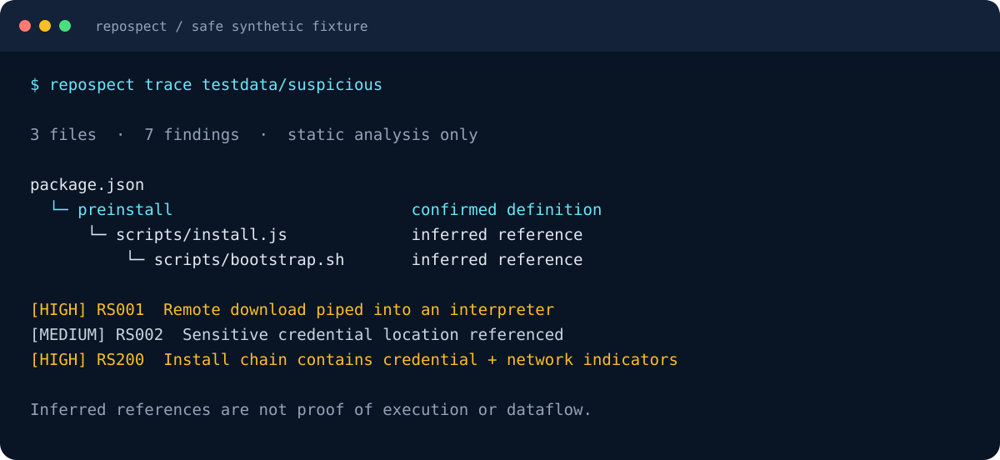

<p align="center">
  
</p>

<p align="center">
  <a href="LICENSE"></a>
  <a href="go.mod"></a>
  <a href="docs/THREAT_MODEL.md"></a>
  <a href="docs/IMPLEMENTATION_STATUS.md"></a>
</p>

<h3 align="center">What could this repository do to your machine?</h3>

<p align="center">Inspect installation hooks, credential access indicators, suspicious commands and unsafe configuration<br/>before you install, build or run unfamiliar code.</p>

<p align="center">
  <a href="#try-it-in-a-minute">Quick start</a> ·
  <a href="#follow-the-execution-path">RepoSpect Trace</a> ·
  <a href="#what-works-today">Features</a> ·
  <a href="docs/ROADMAP.md">Roadmap</a> ·
  <a href="CONTRIBUTING.md">Contribute</a>
</p>

---

RepoSpect is an open-source, local-first security CLI written in Go. It looks for potentially dangerous behavior in repositories and connects static evidence across installation scripts and referenced files.

Every finding includes its location, confidence, potential impact and remediation. **Default static scans never execute repository code.** No account, API key or cloud service is required for local scanning.

> **Early development:** RepoSpect currently combines deterministic lexical rules, manifest parsing and literal file-reference graphs. Findings are indicators for review, not proof of malicious intent or compromise. Read the [coverage limits](docs/LIMITATIONS.md) before using it as a security gate.

## Try it in a minute

Requires **Go 1.24+**. Build from the repository root:

```sh
go build -trimpath -o bin/repospect ./cmd/repospect

# Inspect a local repository without network requests.
./bin/repospect scan /path/to/repository --offline

# Explore the harmless fixture included in this project.
./bin/repospect trace testdata/suspicious
```

On Windows, build `bin/repospect.exe`. Add `bin` to your `PATH` to invoke `repospect` directly. Tagged binary releases are planned; source builds are the current installation path.

## Follow the execution path

A single suspicious line gives you limited context. RepoSpect Trace connects installation entry points with referenced files and the indicators found along them.

<p align="center">
  
</p>

*Selected output from the included inert fixture; labels are shortened for readability. The fixture contains strings and comments, not executable attack behavior. Inferred references do not establish calls or dataflow.*

```sh
repospect trace .
repospect trace . --format json
repospect trace . --format mermaid
repospect trace . --format dot
```

The graph distinguishes **confirmed definitions** from **inferred references**, with evidence for each edge. A lifecycle hook linked to credential and network indicators receives a correlated finding. Language-aware call analysis and credential dataflow are [planned](docs/ROADMAP.md).

## What works today

| Area | Available now | Current boundary |
| --- | --- | --- |
| Repository behavior | Download-and-execute, decoding, dynamic evaluation, process and persistence indicators | Lexical matching includes comments and strings |
| Installation | npm lifecycle hooks, Python build entry points, referenced scripts | No package installation or runtime discovery |
| Trace | Cross-file references and lifecycle/credential/network correlation | No general AST or dataflow engine |
| Dependencies | npm manifests and lockfile v2/v3, pinned Python requirements, Go require declarations | Several lock formats and resolution semantics remain unsupported |
| Vulnerabilities | Explicit opt-in OSV queries for exact package versions | Network required; upstream severity enrichment is planned |
| Secrets | Selected token/private-key patterns and credential-location references | Values are redacted; detection is not comprehensive |
| Infrastructure, CI and agents | Initial rules for containers, GitHub Actions and agent/MCP configuration | Lexical checks, not complete semantic policy analysis |
| Revision comparison | Introduced, resolved and unchanged findings between committed snapshots | Git required; no working-tree or semantic graph comparison |
| Reports | Text, JSON, SARIF, CycloneDX inventory, Mermaid and DOT | Full schema conformance testing remains planned |

**Not implemented:** OCI image scanning, persistent explain-by-ID, provenance verification, general credential dataflow, optional AI explanations and broader language/package support. Unsupported commands fail explicitly. See the [implementation status](docs/IMPLEMENTATION_STATUS.md) and [feature roadmap](docs/ROADMAP.md).

## Choose your inspection

```sh
# Repository and installation behavior
repospect scan .
repospect install-audit .

# Focused checks
repospect deps .
repospect secrets scan .
repospect infra scan .
repospect cicd scan .
repospect agents scan .

# Dependency metadata and optional vulnerability lookup
repospect deps . --format sbom
repospect deps . --osv

# Compare committed revisions
repospect diff --base main --head HEAD --format json

# Acquire an anonymous public GitHub HEAD snapshot
repospect scan https://github.com/org/project
```

Remote retrieval uses a bounded archive download with no Git checkout, hooks, filters or submodule initialization. Local scans do not invoke Git; revision comparison uses Git archives under a controlled environment.

## Use it in CI

```sh
repospect scan . --offline --format sarif --fail-on high > repospect.sarif
```

| Exit | Meaning |
| --- | --- |
| `0` | Completed within the implemented coverage |
| `1` | A finding meets the configured severity threshold |
| `2` | Operational or configuration error |
| `3` | Incomplete input coverage |

Threshold status takes precedence over incomplete coverage. Skipped files and unsupported inputs are reported. A zero exit status is not a guarantee that a repository is safe. Risk priority is deterministic and **is not a probability of compromise**.

Explicit suppressions require a documented review reason:

```json
{
  "suppress": {
    "RS003": "Reviewed template evaluation; tracked in issue 42"
  }
}
```

Pass the file with `--config review.json`. Repository-owned configuration is never loaded automatically. OSV results are not suppressed by this configuration.

## Your code stays local

- **No code execution:** no installation commands, project scripts, build commands or MCP servers are launched during local static scans.
- **No source uploads:** local scans make no network requests. There is no telemetry or AI integration.
- **Explicit network features:** a remote URL requests a GitHub snapshot; `--osv` sends package names, ecosystems and exact versions to OSV. `--offline` forbids both.
- **Redacted evidence:** reports use descriptions rather than source excerpts or raw secret values.
- **Bounded input:** file, byte, directory-depth and graph limits; confined local reads; archive traversal and symlink protections.

See the [threat model](docs/THREAT_MODEL.md), [hardening notes](docs/HARDENING.md) and [security policy](SECURITY.md). Static scanning has blind spots; inspect the evidence and reported coverage.

## Build with us

RepoSpect is early enough for contributors to shape its detection engine and developer experience. Useful starting points:

- Add **benign regression fixtures** that reduce false positives.
- Extend **package inventory parsers** with labeled lockfile fixtures.
- Improve **execution tracing** without executing inspected code.
- Test **Windows/macOS/Linux behavior** and hostile filenames.
- Review **report formats, coverage semantics and documentation**.

Start with the [contribution guide](CONTRIBUTING.md) and [prioritized roadmap](docs/ROADMAP.md). Small, tested changes with clear evidence are welcome. Do not submit real credentials, functional malware or live attack infrastructure.

```sh
go test ./...
go test -race ./...
go vet ./...
```

## Documentation

[Architecture](docs/ARCHITECTURE.md) · [Coverage limits](docs/LIMITATIONS.md) · [Roadmap](docs/ROADMAP.md) · [Validation history](docs/IMPLEMENTATION_STATUS.md) · [Publishing guide](docs/PUBLISHING.md)

## License

[Apache License 2.0](LICENSE). Source and project-owned documentation and assets are distributed under that license. Artwork provenance is documented in [docs/assets/README.md](docs/assets/README.md).
